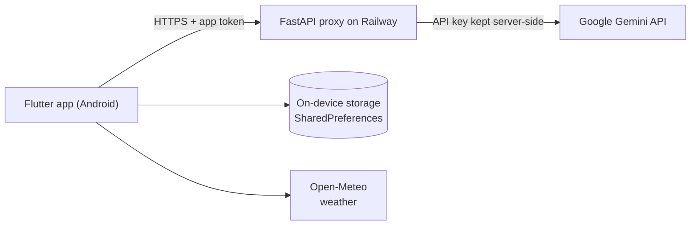

# StyleMate

**Smart digital wardrobe and AI-based outfit recommendation app.**
Photograph your clothes once, let AI tag them, and get outfit suggestions made only from what you already own.


| | |
|---|---|
| **Live backend (Railway)** | `<RAILWAY_URL>` &nbsp;(health check: `<RAILWAY_URL>/health`) |
| **Download APK** | `<APK_LINK>` |

---

## Table of contents
1. [Overview](#overview)
2. [Screenshots](#screenshots)
3. [Features](#features)
4. [How the AI works](#how-the-ai-works)
5. [Architecture](#architecture)
6. [Tech stack](#tech-stack)
7. [Project structure](#project-structure)
8. [Getting started](#getting-started)
9. [Themes](#themes)
10. [Known limitations](#known-limitations)
11. [Roadmap](#roadmap)
12. [Team](#team)

---

## Overview

Most people own more clothes than they realise, yet still feel they have "nothing to wear". The cause is
decision fatigue, forgotten items at the back of the closet, and no record of what has actually been worn.

StyleMate turns a physical wardrobe into a searchable digital one:

- A photo of a garment is analysed by a multimodal AI model, which fills in its category, colour, pattern and season.
- The app recommends outfits for a chosen occasion, weather and style, using **only items the user owns**, and shows the real photos together on an outfit board.
- An "Ask StyleMate" assistant answers questions such as *"Do I already have blue jeans?"* and suggests what is genuinely missing before the user buys something new.
- A calendar and analytics screens show what has been worn and what has been forgotten.

## Screenshots

> Screenshots live in [`docs/screenshots/`](docs/screenshots). File names must match the ones below.

<table>
  <tr>
    <td align="center"><br><sub>Splash</sub></td>
    <td align="center"><br><sub>Login / Sign up</sub></td>
    <td align="center"><br><sub>Personalize (gender sets theme)</sub></td>
    <td align="center"><br><sub>Home</sub></td>
  </tr>
  <tr>
    <td align="center"><br><sub>Add clothing with AI tags</sub></td>
    <td align="center"><br><sub>Wardrobe</sub></td>
    <td align="center"><br><sub>What should I wear? + outfit board</sub></td>
    <td align="center"><br><sub>Ask StyleMate</sub></td>
  </tr>
  <tr>
    <td align="center"><br><sub>Style calendar</sub></td>
    <td align="center"><br><sub>Analytics</sub></td>
    <td align="center"><br><sub>Create outfit</sub></td>
    <td align="center"><br><sub>Profile</sub></td>
  </tr>
</table>

**Three themes, chosen by the user at sign-up**

<table>
  <tr>
    <td align="center"><br><sub>Pink</sub></td>
    <td align="center"><br><sub>Blue &amp; Black</sub></td>
    <td align="center"><br><sub>Beige (neutral)</sub></td>
  </tr>
</table>

## Features

**Accounts**
- Sign up / log in with email-format and common-typo checks (for example `gmail.coom`), live password-match indicator and show/hide password.
- Session is remembered; each account's data is stored separately on the device.

**Digital wardrobe**
- Add items from the camera or gallery.
- AI auto-tagging of category, sub-category, colour, pattern and season, with an editable review step (an "auto-apply" switch skips it).
- Tag picker, category filter, favourites, delete with confirmation.
- Items without a photo get a garment-specific icon (dress, jeans, sneakers, bag, watch and so on).

**Outfits**
- Create, save, view and delete outfits.
- **What should I wear?** Pick occasion, weather and style and get an explanation plus an outfit board of the real photos.
- **Ask StyleMate** is a chat assistant for wardrobe questions; the history is saved per user.

**Planning and insights**
- Style calendar: assign outfits to days (past week to next two weeks).
- Analytics: wardrobe usage percentage, closet-composition donut chart, weekly activity line chart, monthly trends bar chart, most-worn and forgotten items.
- Home shows live or manual-city weather, today's outfit and in-app notifications generated from real wardrobe data.

## How the AI works

| Feature | Input | Output |
|---|---|---|
| Clothing tagging | Photo (Base64) + instruction prompt | JSON: category, sub-category, colour, pattern, season |
| What should I wear? | Wardrobe as text records + occasion / weather / style | JSON: explanation + chosen item IDs |
| Ask StyleMate | Wardrobe as text records + free-text question | Short answer: match found, or what to buy instead |

Design choices that keep the output trustworthy:

- **No model training.** A pre-trained Gemini model is used zero-shot through prompting.
- **No invented clothes.** Returned item IDs are validated against the user's real wardrobe; unknown IDs are discarded.
- **Controlled vocabularies.** Category and season come from fixed lists; Category and Colour are required before an item can be saved.
- **Graceful failure.** On a network error or quota limit the app shows a clear message and leaves tag fields blank instead of saving a wrong guess.
- **Format fallback.** If the model's JSON is malformed, items are matched from the colour and type words in the explanation, so the outfit board still appears.

## Architecture



The Gemini API key and the model name live **only** on the backend (Railway environment variables), so the key is
never shipped inside the APK and the model can be changed without rebuilding the app. Wardrobe data stays on the device.

## Tech stack

| Layer | Technology |
|---|---|
| App | Flutter, Dart |
| State management | Provider |
| AI | Google Gemini API (default model `gemini-3.5-flash-lite`, set on the server) |
| Backend | FastAPI, httpx, Uvicorn, deployed on Railway |
| Local storage | SharedPreferences (JSON, scoped per user) |
| Weather | Open-Meteo (forecast + geocoding), ipapi.co / ipwho.is for approximate location, manual city override |
| Charts | fl_chart |
| Images | image_picker |
| Typography | google_fonts |
| App icon | flutter_launcher_icons |

## Project structure

```
stylemate/
├── backend/                 # FastAPI AI proxy (deployed on Railway)
│   ├── main.py
│   ├── requirements.txt
│   └── Procfile
├── lib/
│   ├── config/              # api_config.dart (git-ignored) and api_config.example.dart
│   ├── models/              # UserModel, ClothingItem, Outfit, CalendarEntry
│   ├── services/            # Auth, Wardrobe, AI, Weather, Notification
│   ├── theme/               # three themes, backgrounds, icon styles
│   ├── widgets/             # shared UI pieces
│   └── screens/             # auth, onboarding, home, wardrobe, outfit,
│                            # calendar, analytics, notifications, profile
├── assets/images/
├── docs/screenshots/        # images used in this README
└── pubspec.yaml
```

## Getting started

### Prerequisites
- Flutter SDK (stable) and an Android phone with USB debugging, or an emulator
- A Google Gemini API key from [Google AI Studio](https://aistudio.google.com)
- A Railway account (to host the backend)

### 1. Deploy the backend (Railway)
1. Push this repository to GitHub.
2. On Railway choose **New Project, Deploy from GitHub repo**, select this repository and set **Root Directory** to `backend`.
3. Add these variables:

   | Variable | Value |
   |---|---|
   | `GEMINI_API_KEY` | your Gemini API key |
   | `APP_TOKEN` | a long random string (the app sends the same value) |
   | `GEMINI_MODEL` | optional, default `gemini-3.5-flash-lite` |

4. Under Settings, Networking, click **Generate Domain**.
5. Open `<your-url>/health`. You should see `"status":"ok"` and `"gemini_key_configured":true`.

Endpoints: `GET /health`, and `POST /generate` (header `x-app-token`, body is a Gemini `generateContent` request).

### 2. Run the app
```bash
git clone https://github.com/siddiquafathima/stylemate.git
cd stylemate
flutter create .            # only if the android/ folder is missing
flutter pub get
copy lib\config\api_config.example.dart lib\config\api_config.dart     # macOS/Linux: cp
```
Edit `lib/config/api_config.dart`:
```dart
const String aiBackendUrl = 'https://your-service.up.railway.app';
const String aiAppToken = 'the same APP_TOKEN you set on Railway';
```
Then run:
```bash
flutter run
```
`api_config.dart` is git-ignored so your token is never committed.

### 3. Build an APK
Add `<uses-permission android:name="android.permission.INTERNET"/>` to
`android/app/src/main/AndroidManifest.xml` (above `<application`), because release builds have no internet access without it. Then:
```bash
flutter build apk --release
```
The file is created at `build/app/outputs/flutter-apk/app-release.apk`.

### Changing the app icon
Replace `assets/images/app_icon_source.png` with your logo, then run `dart run flutter_launcher_icons`.

## Themes

The user picks Female, Male or Neutral during onboarding and the whole app changes immediately; there is no separate theme page.

| Choice | Theme | Character |
|---|---|---|
| Female | Pink | rounded corners, hearts-and-sparkles background, rounded icons |
| Male | Blue & Black | sharp corners, geometric background, sharp icons |
| Neutral | Beige (default) | calm, warm, outlined icons |

Beige is also used on the splash, login and sign-up screens, and again after logging out.

## Known limitations

- Wardrobe data and accounts are stored on the device only (no cloud sync). The prototype stores passwords locally without hashing, and the forgot-password flow is simulated.
- The backend is protected by one shared app token that ships inside the APK. This limits casual misuse but is not per-user authentication.
- The free Gemini tier is rate limited; heavy use can return HTTP 429 until the quota resets.
- Saved items cannot be edited yet (delete and re-add).
- AI tags can occasionally be wrong, which is why a review step exists.
- IP-based weather can show the wrong city; a manual city can be set.
- The outfit board is an arrangement of the user's real photos, not an AI-generated image.
- Built and tested on Android only; no iOS build.
- No formal accuracy measurement of the AI tagging has been done yet; testing so far is manual on a physical device.

## Roadmap

- Firebase Authentication and Firestore for secure accounts and multi-device sync
- AI Outfit Customizer (choose pieces, get a coordinated look) and Outfit Visualizer
- Edit screen for saved items
- Measured accuracy report for AI tagging on a labelled photo set
- iOS build

## Team

Mobile Application Development (MAD) project, Group 8, Jain (Deemed-to-be University), Bengaluru.

| Name | USN |
|---|---|
| Siddiqua Fathima | 25MCAR0121 |
| Erika Fernandes | 25MCAR0092 |